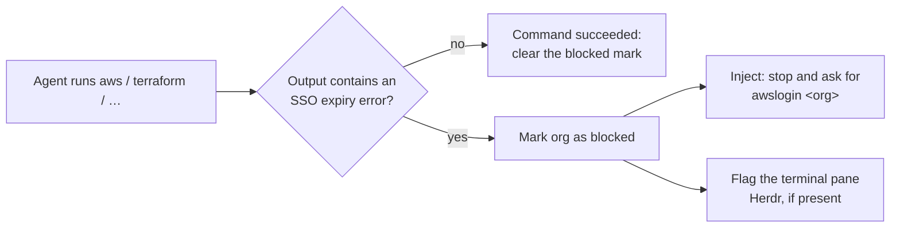

# AI coding agents

`rolehop` teaches AI coding agents how to work with your AWS profiles:

- **Choose freely.** Pick whatever profile and role the task needs — Admin included — read the catalog with `rolehop list`, and say which profile was used.
- **Never touch credentials.** Do not read `~/.aws`, export keys, or paste portal access keys.
- **Stop on expiry.** When the SSO session ends, stop retrying, do not switch to another profile to work around it, and ask the user to run `awslogin <org>`.
- **Unattended work.** Before the user leaves, ask them to run `rolehop run --login --max <duration>`. Infrastructure changes go through PRs and pipelines.

## Commands

```bash
rolehop agent list                    # detected agents and what is installed
rolehop agent install                 # install into detected agents
rolehop agent install claude codex    # install into specific agents
rolehop agent install --dry-run       # preview
rolehop agent uninstall --all         # remove everything
rolehop agent rules                   # print the rules (e.g. to paste into Cursor)
```

## Support matrix

| Agent | Global instructions | Session-expired hook |
|---|---|---|
| Claude Code | `~/.claude/rules/aws.md` | :lucide-check: `PostToolUse` / `PostToolUseFailure` + `deny` rules + `CwdChanged` (direnv) |
| OpenAI Codex CLI | block in `~/.codex/AGENTS.md` | :lucide-check: `~/.codex/hooks.json` — approve it with `/hooks` |
| Kiro (CLI and IDE) | `~/.kiro/steering/aws.md` | — |
| GitHub Copilot CLI | block in `~/.copilot/copilot-instructions.md` | :lucide-check: `~/.copilot/hooks/rolehop.json` |
| Gemini CLI | block in `~/.gemini/GEMINI.md` | :lucide-check: `AfterTool` |
| Qwen Code | block in `~/.qwen/QWEN.md` | :lucide-check: `PostToolUse` |
| OpenCode · Amp · Pi · Devin Desktop (Windsurf) | block in their `AGENTS.md` / `global_rules.md` | — |
| Cursor | no global file: paste `rolehop agent rules` in **Settings → Rules** | uses the Claude Code hooks |

Everything is idempotent and backed up. In shared files such as `AGENTS.md`, `rolehop` only adds or replaces its own marked block and leaves the rest untouched.

## How the hook works

After every shell command the agent runs, the hook (`rolehop hook post-tool --format <agent>`) inspects the result:



- It only reacts to AWS-related commands (`aws`, `terraform`, `tofu`, `terragrunt`, `cdk`, `sam`, `eksctl`, `kubectl`, or anything with `AWS_PROFILE=`).
- On success it looks at `stderr` only, so CloudTrail logs or files that happen to contain `ExpiredToken` do not raise false alarms.
- A hook never breaks the agent session: any internal error exits silently.

## Claude Code permission rules

For Claude Code, `rolehop` also merges these `deny` rules into `~/.claude/settings.json`. They block credential leaks, not roles:

```text
Read(~/.aws/**)          Edit(~/.aws/**)
Bash(aws configure export-credentials *)
Bash(aws configure get *)
Bash(aws sso get-role-credentials *)
Bash(aws sso login *)    Bash(awslogin *)
Bash(rolehop login *)    Bash(rolehop run --login *)
Bash(assume *)           Bash(granted *)
Bash(direnv allow *)
```

!!! warning "Rules are guidance, not a sandbox"

    Instructions guide well-behaved agents. Protect your machine with each agent's own mechanisms as well — sandboxing and permission rules.
