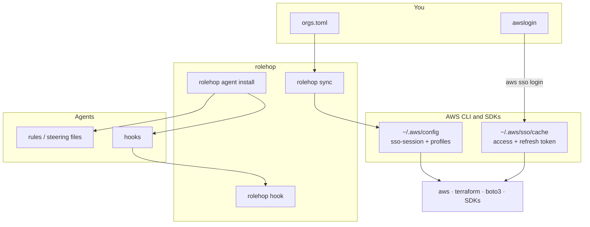

# How it works

`rolehop` is a thin layer over the **native** AWS CLI and SDK behaviour. It never implements OAuth, never stores tokens and never writes credentials: it writes configuration, and the AWS CLI does the rest.

## Architecture



## The two clocks

1. **Role credentials** — issued per permission set, with the duration your administrator configured (for example one hour for Administrator). With an `sso-session` that has the `sso:account:access` registration scope, the CLI holds a **refresh token** and silently obtains new role credentials whenever they expire.
2. **Portal session** — the IAM Identity Center session started by `aws sso login`. When it ends, refresh stops working for every profile of that organization, and you run `awslogin` again.

`rolehop` does not change either duration. It only makes sure you depend on the second one, and that humans and agents react correctly when it ends.

## Managed blocks

`sync` owns only what is between its markers in `~/.aws/config`:

```ini
# >>> rolehop:<org> (managed by rolehop, do not edit) >>>
…
# <<< rolehop:<org> <<<
```

Everything outside those markers is preserved byte for byte. Each write:

1. validates `orgs.toml` completely;
2. detects conflicts with your own sections;
3. renders the new file and parses it as INI;
4. writes a timestamped backup;
5. writes atomically (temporary file, `fsync`, rename) with mode `0600`, following symlinks to their target.

## State

Small, non-secret JSON files in `~/.local/state/rolehop/<org>.json` record the time of the last login (for the estimate) and whether a hook marked the organization as blocked. Nothing in there grants access to anything.

## Discovery

`init` and `discover` read the SSO access token from the AWS CLI cache file (`~/.aws/sso/cache/<sha1(session)>.json`) **in memory**, and call the AWS access portal REST API with the standard library:

- `GET /assignment/accounts` — accounts you can access
- `GET /assignment/roles` — permission sets per account

The token is never printed, logged or written anywhere.
